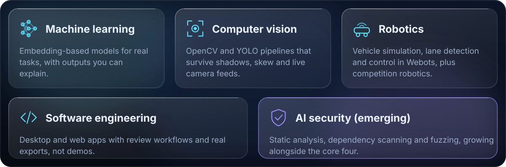
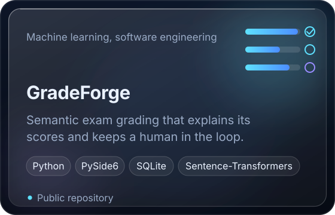
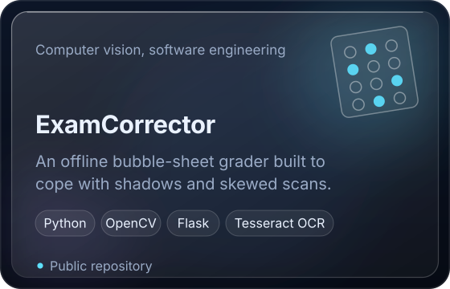
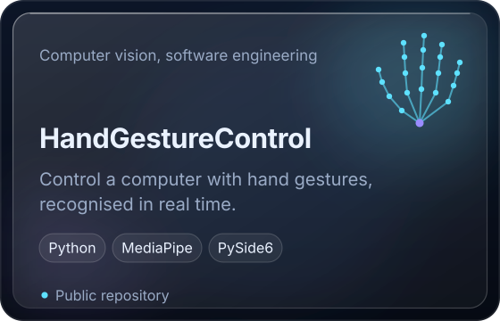
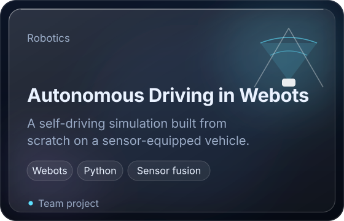
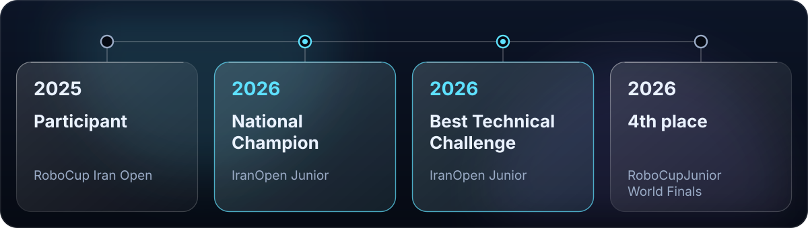
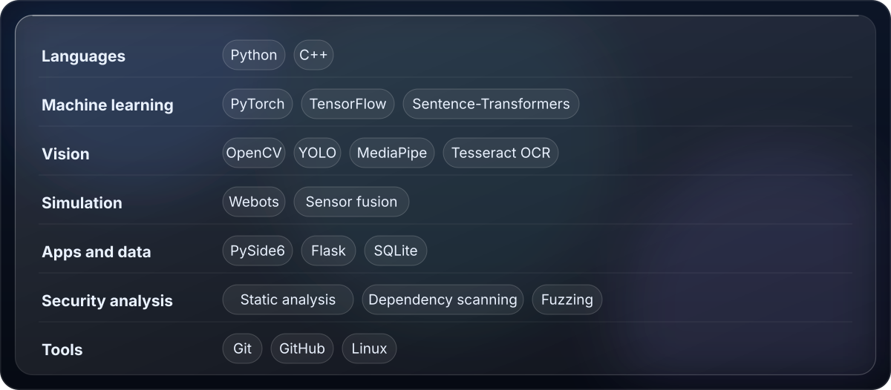
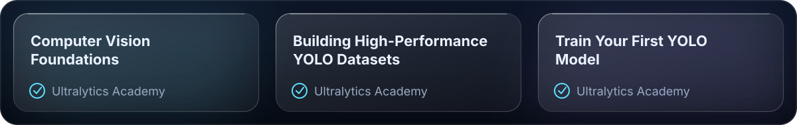
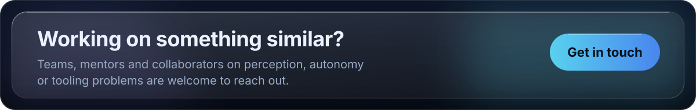

[Website](https://samnia.vercel.app) &nbsp;|&nbsp; [Projects](https://samnia.vercel.app/projects) &nbsp;|&nbsp; [Systems map](https://samnia.vercel.app/systems) &nbsp;|&nbsp; [LinkedIn](https://www.linkedin.com/in/amirsam-eftekharinia/)

## About

I build systems at the intersection of artificial intelligence, computer vision and robotics, with a growing interest in AI security. I would rather build than only study: exam-grading pipelines, offline computer-vision graders, security analysis platforms and autonomous driving in simulation.

## Focus

## Selected work

<table>
  <tr>
    <td width="50%"></td>
    <td width="50%"></td>
  </tr>
  <tr>
    <td width="50%"></td>
    <td width="50%"></td>
  </tr>
</table>

Also worth a look: [**BlueLine**](https://github.com/AmirSam-Eftekhari/BlueLine), an offline security analysis platform that combines static analysis, dependency vulnerability detection, dynamic testing and fuzzing into one report. Competition robotics code stays private under team policy. Every project, with scope and what is public, is on the [projects page](https://samnia.vercel.app/projects).

## Competition record

## Stack

## Credentials

Verify: [Computer Vision Foundations](https://academy.ultralytics.com/courses/computer-vision-foundations/certificate/18b45788-a066-4d91-8234-c339c9e24239) &nbsp;|&nbsp; [YOLO Datasets](https://academy.ultralytics.com/courses/dataset-readiness-for-yolo/certificate/cb676cf9-ac4f-43e2-808f-2287cf2eb135) &nbsp;|&nbsp; [First YOLO Model](https://academy.ultralytics.com/courses/train-your-first-yolo/certificate/5384a777-e4e4-4cfd-9dce-589c86fbead1)

 

[Email](mailto:samnia2010@gmail.com) &nbsp;|&nbsp; [LinkedIn](https://www.linkedin.com/in/amirsam-eftekharinia/) &nbsp;|&nbsp; [Instagram](https://instagram.com/sam_nia0)

