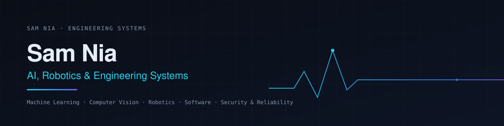
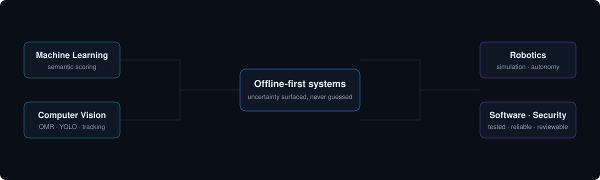

  

  <a href="#focus">Focus</a> ·
  <a href="#featured-systems">Featured systems</a> ·
  <a href="#competitions">Competitions</a> ·
  <a href="#credentials">Credentials</a> ·
  <a href="PORTFOLIO.md">All projects</a> ·
  <a href="https://samnia.vercel.app">Website ↗</a>

I build perception, autonomy and software systems end to end: offline-first pipelines, explainable
grading, gesture interfaces, security tooling and autonomous driving in simulation. Each project below is a
complete, reviewable system with documentation, not a demo.

## Focus

| Area | Evidence in public work |
|---|---|
| **Machine learning** | Semantic, explainable exam grading in [GradeForge](https://github.com/AmirSam-Eftekhari/GradeForge) |
| **Computer vision** | OMR in [ExamCorrector](https://github.com/AmirSam-Eftekhari/ExamCorrector-), real-time tracking in [HandGestureControl](https://github.com/AmirSam-Eftekhari/HandGestureControl), dataset diagnostics in [ImageAudit](https://github.com/AmirSam-Eftekhari/ImageAudit) |
| **Robotics** | Competition robotics, and lane detection and vehicle control in Webots (simulation repository not yet public) |
| **Software engineering** | Desktop and web applications with test suites, CI and packaged releases |
| **Security & reliability** | Static analysis, fuzzing and correlated reporting in [BlueLine](https://github.com/AmirSam-Eftekhari/BlueLine) |

## Featured systems

<!-- portfolio:featured:start -->
#### [GradeForge](https://github.com/AmirSam-Eftekhari/GradeForge)
AI & Machine Learning · Python · PySide6 · SQLite · Sentence-Transformers

Offline-first, multilingual desktop app for grading descriptive exams. Combines semantic similarity and concept coverage into explainable, confidence-aware scores, with local history, analytics and report export.

**Evidence:** Documented architecture and grading pipeline, desktop and CLI interfaces, MIT licence.

[Repository](https://github.com/AmirSam-Eftekhari/GradeForge)

#### [ExamCorrector](https://github.com/AmirSam-Eftekhari/ExamCorrector-)
Computer Vision · Python · OpenCV · Flask · Tesseract OCR

Offline OMR platform for photographed or scanned bubble sheets. Registers each page with corner markers, grades against an answer key, and flags uncertain marks for human review instead of guessing.

**Evidence:** CI workflow, 52 test functions, English and Persian printable templates, SECURITY.md and CITATION.cff.

[Repository](https://github.com/AmirSam-Eftekhari/ExamCorrector-)

#### [BlueLine](https://github.com/AmirSam-Eftekhari/BlueLine)
Security & Reliability · Python · Fuzzing · Static analysis

Offline security and reliability assessment platform: Python static analysis, web/API checks, ELF/PE/Mach-O binary analysis, dynamic testing and behaviour-guided fuzzing, with correlated, confidence-rated reports.

**Evidence:** v1.0.0 release, 200 test functions, purpose-built vulnerable test targets.

[Repository](https://github.com/AmirSam-Eftekhari/BlueLine) · [Release v1.0.0](https://github.com/AmirSam-Eftekhari/BlueLine/releases/tag/v1.0.0)

#### [HandGestureControl](https://github.com/AmirSam-Eftekhari/HandGestureControl)
Computer Vision · Python · MediaPipe · PySide6

Real-time hand-gesture desktop control: MediaPipe tracking, temporal smoothing, custom gesture recording, gesture-to-action mapping and a modular PySide6 interface.

**Evidence:** v1.0.0 release, 125 test functions, Windows build tooling.

[Repository](https://github.com/AmirSam-Eftekhari/HandGestureControl) · [Release v1.0.0](https://github.com/AmirSam-Eftekhari/HandGestureControl/releases/tag/v1.0.0)

#### [ImageAudit](https://github.com/AmirSam-Eftekhari/ImageAudit)
Computer Vision · Python · FastAPI · Docker

Local-first auditing for YOLO datasets: integrity, image quality, annotation errors, duplicates and train/val/test leakage, scored and reported as HTML, PDF, JSON and CSV via CLI, web dashboard or single-file Windows executable.

**Evidence:** v1.0.0 release, CI on Linux and Windows, 167 test functions, Docker support.

[Repository](https://github.com/AmirSam-Eftekhari/ImageAudit) · [Release v1.0.0](https://github.com/AmirSam-Eftekhari/ImageAudit/releases/tag/v1.0.0)
<!-- portfolio:featured:end -->

More public work is indexed automatically in [PORTFOLIO.md](PORTFOLIO.md).

## Competitions

| Year | Event | Result |
|---|---|---|
| 2025 | RoboCup Iran Open | Participant |
| 2026 | IranOpen Junior | National Champion |
| 2026 | IranOpen Junior | Best Technical Challenge |
| 2026 | RoboCupJunior | 4th place, world finals |

Results are self-reported; no public result page is linked yet. Competition robotics code is a team project and is not public.

## Credentials

Ultralytics Academy certificates:
[Computer Vision Foundations](https://academy.ultralytics.com/courses/computer-vision-foundations/certificate/18b45788-a066-4d91-8234-c339c9e24239) ·
[Building High-Performance YOLO Datasets](https://academy.ultralytics.com/courses/dataset-readiness-for-yolo/certificate/cb676cf9-ac4f-43e2-808f-2287cf2eb135) ·
[Train Your First YOLO Model](https://academy.ultralytics.com/courses/train-your-first-yolo/certificate/5384a777-e4e4-4cfd-9dce-589c86fbead1)

**Contact:** [samnia.vercel.app](https://samnia.vercel.app) · [LinkedIn](https://www.linkedin.com/in/amirsam-eftekharinia/) · [Instagram](https://instagram.com/sam_nia0) · [Email](mailto:samnia2010@gmail.com)

The featured section and PORTFOLIO.md are generated from <a href="portfolio.yml">portfolio.yml</a>; see <a href="docs/MAINTAINING.md">docs/MAINTAINING.md</a>.
